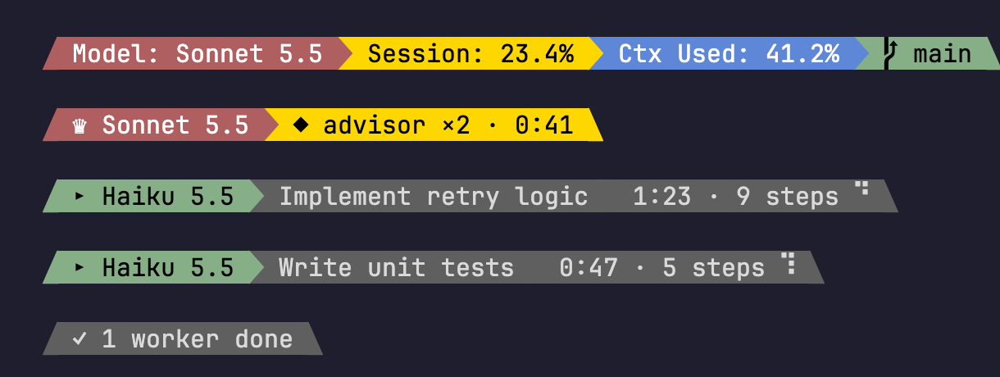

# claude-kit

Three customizations for [Claude Code](https://claude.com/claude-code) that I use every day. Each one stands alone: install one, two or all three.

| Folder | What it is |
|---|---|
| [`model-band/`](model-band/) | A status line mod: model, limits and context at a glance, plus one row per running agent. |
| [`brain/`](brain/) | Shared notes every Claude session reads, for facts that cross repos, kept fresh by a weekly check. |
| [`output-style/`](output-style/) | The `adhd` output style: answer first, short bullets, safety caveats never cut, plus a linter for it. |

Built and used on macOS. Needs `jq`.

---

## model-band: who is working, on what, and how close to the limit

A powerline status line in two bands:

- **Status band:** lead model, then the 5-hour limit and context used as 5-step meters, then when the 5-hour window resets. The last segment goes green to red as the 5-hour use climbs. Below it, Claude Code's hint line, shortened, with the git branch.
- **Agents band:** one row per running worker: model, task label, elapsed time, steps and tokens read. Four rows at most, then `+N more`. The band disappears 15 minutes after the last update.

Why it helps: see at once who works on what; spot a stuck agent (time runs, steps don't); see when a worker reads too much (its token count turns amber, then red).

How: a mod (`hooks/register.tsx`) listens to session, agent and turn events and writes the team to `~/.claude/model-band/<session-id>.json`; the status line script (`bin/statusline.sh`) draws it with `jq`. `/model-band on|off` toggles it.

Needs a Nerd Font for the powerline arrows. Install and details: [model-band/README.md](model-band/README.md).

## brain: one set of notes every session reads

Project memory sees one repo. The brain holds the links between them: which service reads which spec, how a release in one repo reaches another, tooling quirks you verified once and don't want to rediscover.

- **What:** a plain folder of Markdown in `~/brain`, a local git repo with no remote. Obsidian is optional: Claude reads the files directly; open the folder as a vault only if you want a graph and clickable links.
- **Read:** its `index.md` is imported into every session from `~/.claude/CLAUDE.md`. A note opens only when its index line matches the task.
- **Write:** one topic per note, every claim dated (`verified:`) and sourced (`source:`). No secrets, no copies of repo docs. Rules in [brain/RULES.md](brain/RULES.md).
- **Reminder:** a Stop hook asks each longer session (15+ tool calls) once whether it verified something worth a note. It never loops.
- **Upkeep:** a weekly check with no model finds stale notes (older than 90 days, a source file changed since `verified`, an index over budget, dead links). Only if it finds some does Sonnet re-check exactly those and commit.

This folder ships the system and one example note, not anyone's notes. Install and details: [brain/README.md](brain/README.md).

## output-style: replies you can read in five seconds

The `adhd` output style changes how Claude writes, not how it codes:

- The answer or result first, in bold.
- Short bullets, one idea each: aim for 15 words, never over 25.
- Icons only where they carry meaning: ❌ broken, ⚠️ you must act, ✅ done or the safe way.
- About 15 lines; a quick question 5 or fewer. Decisions come as numbered options, a recommendation and one yes/no question.
- Never cut: what a fix changes or breaks, how to undo it, the safer alternative, safety caveats.
- An **investigation budget** keeps Claude from reading and deliberating more than the answer needs.

`reply-lint` scores a reply against the style (`reply-lint --check reply.md`): length, bold first line, bullet length, stray icons, second summaries, narration and more. `./test.sh` runs its cases.

Install and details: [output-style/README.md](output-style/README.md).

---

## License

MIT, see [LICENSE](LICENSE).
