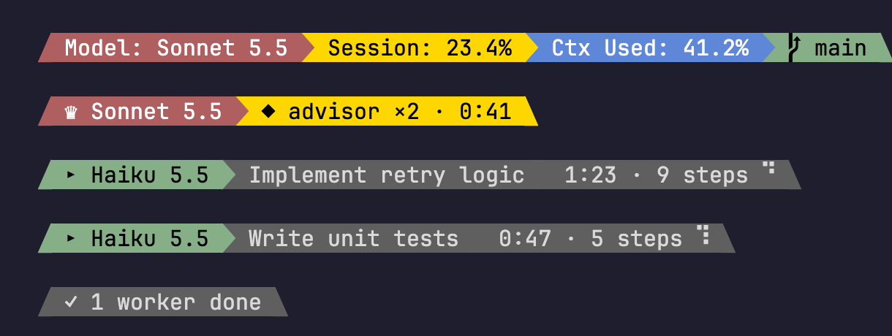

# model-band

A live band under the Claude Code prompt that shows who is doing the work: the lead model, the advisor, and one row per running worker.



## What you see

| Row | Meaning |
|-----|---------|
| Powerline bar | Model, then 5-hour limit and context used as 5-step meters (`5h ▰▱▱▱▱ 8%`, `ctx ▰▰▱▱▱ 39%`) |
| Hint line | Claude Code's line under the prompt, shortened: no `(shift+tab to cycle)`, `← agents`, the git branch at the end (`⎇ main`) |
| `♛ Sonnet 5.5` | The lead model of this session |
| `◆ advisor ×2 · 0:41` | Advisor calls this session and the time they took |
| `▸ Haiku 5.5 · label · 1:23 · 9 steps` | One row per running worker (four at most, then `+N more`), with a spinner |
| `⚙ label · Model · 1:30 · working · 40 % ▰▰▱▱▱ · note` | One row per background job (a separate Claude session watched by `bin/job-state.sh`; optional). The `40 %` and 5-cell bar are the job's own estimate (newest `[NN%]` report in its `progress.md`, read by `job-state.sh`); no percentage, no segment. `bin/cmd-state.sh` rows (plain commands) take an optional percentage as 6th argument |
| `⟳ 14:30` | Last segment: when the 5-hour window closes, `⟳ in 34m` in the last hour. Green to red with the 5h usage |

With no workers running, the lead and advisor join the first row. The band disappears 15 minutes after the last update.

## How it works

Two parts, because a status line cannot see the session's workers:

- **The mod** (`hooks/register.tsx`) listens to `session.start`, `ui.render` (`PromptHint`), `agent.spawn`, `turn.step` and `turn.complete`, and writes the team to `~/.claude/model-band/<session-id>.json` whenever it changes.
- **The status line** (`bin/statusline.sh`) reads that file with `jq` and draws the rows. State files older than a day are deleted.

## Install

Part of [claude-kit](../README.md). Needs `jq` and a Nerd Font (for the powerline arrows).

```sh
ln -sfn "$PWD/model-band" ~/.claude/skills/model-band   # run from the claude-kit checkout
```

Then point the status line at the script in `~/.claude/settings.json`:

```json
"statusLine": {
  "type": "command",
  "command": "~/.claude/skills/model-band/bin/statusline.sh",
  "padding": 0,
  "refreshInterval": 2
}
```

## Use

`/model-band` toggles the band, `/model-band on` and `/model-band off` set it. Hidden, the status line keeps its own bar.

## Develop

- `bin/test-statusline.sh` checks the status line against sample state.
- `hooks/model-band.test.tsx` covers the mod.
- The screenshot is the real script run on a fake session, rendered with headless Chrome.
